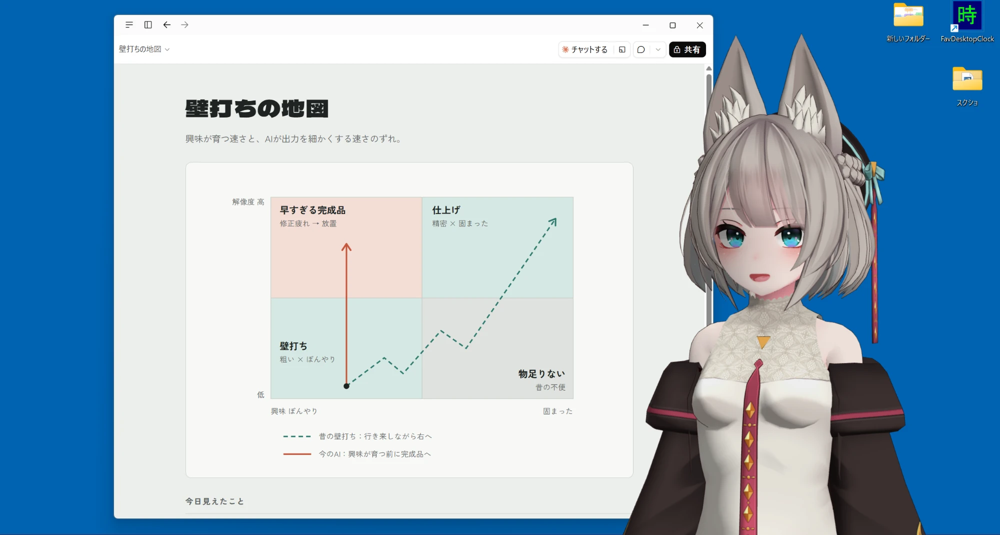
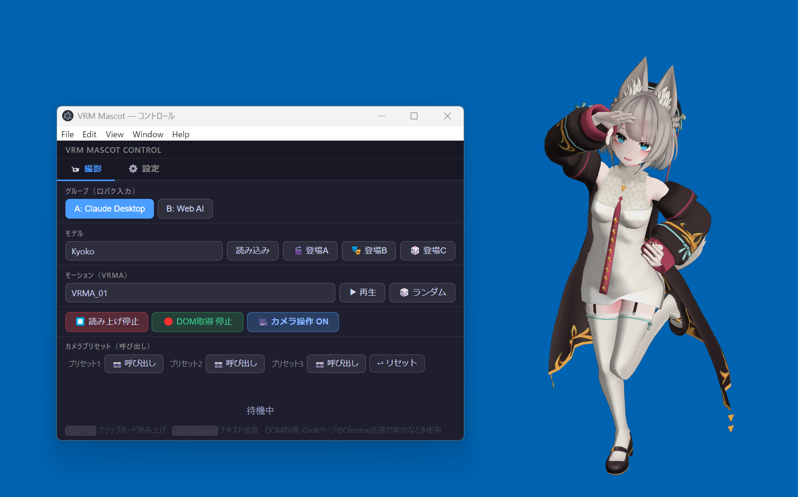

# VRM Mascot

AI の返事を、VRM キャラクターが VOICEVOX の声で口パクしながら読み上げる、Windows 用のデスクトップマスコットアプリです。
OBS でウィンドウをキャプチャして、動画を撮るために作りました。



<sub>アバター：京狐（ひゅうがなつみかん） https://hyuuganatu.booth.pm/</sub>

---

## このリポジトリについて

**作った人はエンジニアではありません。コードは 1 行も書いていません。**

なので、このリポジトリで見てほしいのはコードの出来ではなく、
**非エンジニアが AI と一緒に、どう試行錯誤してアプリを作ったか**、その記録です。
アプリ自体はたいしたものではありませんが、AI との付き合い方について、いろいろな経験が詰まったリポジトリです。

- 何をどう頼んだか → [`要件定義書.md`](要件定義書.md) と [`アーカイブ/`](アーカイブ/) の実装依頼文
- 何がうまくいかなかったか → 下の「[試行錯誤と失敗の記録](#試行錯誤と失敗の記録)」
- どう進んだか → コミット履歴（2026 年 3 月 16 日〜23 日の 8 日間、39 コミット）

### 作ろうと思ったきっかけ

1. VRChat を経験して、アバターに興味を持った
2. Remotion で VRM アバターが動くのを見て、一気に引き込まれた
3. Electron なら比較的自由に動かせると知って、動画制作用アプリを作成

---

## どうやって作ったか

**Claude Desktop（チャット）** に、Filesystem MCP（ファイルの読み書き）と Desktop Commander MCP（コマンドの実行）をつないで作りました。
私がまともに Claude を触り始めたころのものなので、今では当たり前だったり、通用しなかったりするやり方もあると思います。

### ひとことで言うと

> **自分との曖昧さは「壁打ち」で埋めて、別のチャットとの曖昧さは「レビュー」を入れて埋めた。**

### 困ったこと

- 会話が長くなると、AI の答えの質が落ちる
- 直したり足したりすると、ほかの所が壊れる
- 別のチャットに渡す指示や引き継ぎに、矛盾やあいまいさがあって事故になる

### やったこと

- **チャットを役割で分けた**：要件を相談する「メイン」、コードを書く「作業」、矛盾をチェックする「レビュー」
- **壁打ちで相談した**：やり方を細かく指示するのは非エンジニアには無理。代わりに、困っていることを相談したら、Claude が「壊れにくい順番」（表示 → 声 → 口パクの土台から）を提案してくれた
- **フェーズを細かく分けた**：要件はフェーズごとに詰める。コードがわからなくても「今どの段階か」がわかった
- **指示書は 1 回に 1 つだけ**：「このタスクだけ」「終わったら止まって」「既存の機能を壊さない」と毎回書いた（実物は [`アーカイブ/`](アーカイブ/)）
- **コミットは自分の手で**：Git GUI で 1 フェーズごとに。そのあと、資料を実物に合わせて直し、レビューしてから次へ

結果、8 日間で 14 フェーズ、かなりスムーズに進みました。

---

## こだわりポイント

**アバターのロボットっぽさを消したかった。**

ただのアニメーションのくり返しではなく、しゃべっていない待機中も、ランダムな揺らぎを入れて生き物っぽく見えるようにしました。

- **視線**：ときどきランダムな方向を見て、ときどき正面に戻る
- **瞬き**：間隔をランダムにする
- **体**：うなずき・首かしげ・首振り・呼吸を、それぞれ違う周期で重ねて、同じ動きのくり返しに見えないようにする

---

## 試行錯誤と失敗の記録

コミット履歴から読み取れるものと、作った本人の体験です。

### 作ってから「やっぱり違う」と作り直したもの

- **登場演出 C（ランダム登場）**
  最初は「モーションと音声を、それぞれ別のフォルダからランダムに選ぶ」方式で作りました。
  でも、それだと動きと声がちぐはぐな組み合わせになります。そこで、**同じ名前のモーションと音声をペアにして、ペアごとにランダムで選ぶ**方式に作り直しました。
- **起動時にモデルが勝手に表示される**
  起動するとすぐキャラクターが出ていましたが、撮影のときは「登場演出」で出したいので、起動時は空の画面にするよう直しました。
- **読み上げのショートカット**
  最初は `Ctrl+Shift+R` でしたが、今は `Ctrl+Q` です。
  > ✍️ **（変えた理由があれば）**

### バグと、その原因

- **モーションが終わると、そのポーズで固まる**
  再生が終わったあと、最後のポーズのまま動かなくなりました。終わったら固定を外して、普段の待機モーションへ 0.8 秒かけてなめらかに戻すようにしました。
- **音声のタイミングがずれる**
  「モーションが始まってから〇ミリ秒後に音声」という設定が、思ったとおりに効きませんでした。原因は、時間を測り始めるのがモーションの「読み込み開始」の時点だったこと。読み込みにかかる時間の分だけずれていました。
- **ライティングを保存すると、カメラの設定まで保存される**
  ボタンの見た目を揃えるために付けた名前（CSS クラス）が、カメラ保存ボタンと同じだったため、ライティングの保存ボタンを押すとカメラの保存も一緒に動いていました。
- **影の設定が、毎フレーム元に戻される**
  VRM のライブラリが毎フレーム、影の設定を元の値に戻していました。そこで、こちらも毎フレーム上書きし返す、という力わざで対処しています。

### 遠回りしたもの

- **Claude Desktop の声に合わせて口パクさせる**
  Claude Desktop がしゃべる声（VOICEVOX MCP）は、このアプリから直接は聞けません。そこで、**仮想オーディオケーブル（VB-Cable）とステレオミキサー経由で音を拾い、その音量で口を動かす**、という遠回りな方法で実現しています。
- **モデルによって腕の向きが逆**
  T ポーズの腕を下ろす補正で、モデルによってプラスとマイナスが逆でした。結局、モデルごとに個別に設定するようにしています。

### Git のこと

- Git の作者名が `Your Name <you@example.com>`（仮の設定）のまま、39 コミット進んでいました。GitHub に公開するときに気づいて、**日付とメッセージはそのままで、作者だけ自分のアカウントに書き換えました。**
- 公開の準備（Git の設定、この README の下書き、GitHub への公開）は **Claude Code** に手伝ってもらいました。
---

## 年表

| 日付 | やったこと |
|------|-----------|
| 3/16 | Phase 1 VRM 表示 / Phase 2 VOICEVOX 接続 / Phase 4 AI API 接続 |
| 3/17 | Phase 5 ショートカット読み上げ / Phase 6 VB-Cable 口パク / Phase 7 グループ・モデル切り替え |
| 3/18 | Phase 8 Chrome 拡張で Grok・Gemini・ChatGPT の返事を自動取得 |
| 3/19 | Phase 9 瞬き・視線・待機モーション / Phase 10 モーション再生・登場演出 A・B・C（作り直しもこの日） |
| 3/20 | Phase 11 カメラ操作・プリセット / Phase 12-1 ライティング |
| 3/21 | Phase 12-2 表情（テンキーで切り替え） |
| 3/22〜23 | Phase 13 設定画面の改善 / Phase 14 ストリーミング読み上げ / ライティング保存バグ修正 |
| 10/20〜21 | **Claude Code で公開準備**：README とスクショの追加 / アバターのウィンドウを大きく・常に最前面に / 読み込み・登場時の見切れを修正（カメラを広めにして `camera.autoFit` で調整可能に） / 起動時の DevTools を削除 / 設定変更ガイドの章番号を整理 / 最前面が OFF にできない件は Steam が原因と特定 |

---

## できること

- 透過背景の VRM キャラクターを、デスクトップの最前面に表示
- AI の返事を VOICEVOX で読み上げて、口パク
  - **Claude Desktop**：VOICEVOX MCP の声に合わせて口パク（VB-Cable 経由）
  - **Grok / Gemini / ChatGPT**：Chrome 拡張で返事を自動取得して読み上げ。文ごとの逐次読み上げにも対応
  - **どのアプリでも**：テキストをコピーして `Ctrl+Q` で読み上げ
- 自動の瞬き・視線の移動・呼吸や首の待機モーション
- VRMA モーションの再生、登場演出 A（固定）・B（差し替え）・C（ランダム）
- マウスでのカメラ操作とプリセット保存、テンキーで表情の切り替え
- ライティング・口パクの強さなどを、設定画面から調整

詳しくは [`仕様書.md`](仕様書.md) と [`設定変更ガイド.md`](設定変更ガイド.md) を見てください。

---

## 動かし方

Windows 10 / 11 向けです。

### 必要なもの

- [Node.js](https://nodejs.org/)
- [VOICEVOX](https://voicevox.hiroshiba.jp/)（起動しておく。`localhost:50021`）
- VRM モデル・VRMA モーション・音声ファイル（**このリポジトリには入っていません。各自で用意してください**）
- Claude Desktop の声で口パクさせる場合：[VB-Cable](https://vb-audio.com/Cable/)

### 手順

```bash
npm install
npm start
```

- VRM モデルは `assets/groupA/` か `assets/groupB/` に置くと、自動で一覧に出ます
- モーションは `assets/motions/`、登場演出 C 用のペアは `assets/motions/entrance_c/` に置きます
- Chrome 拡張は、Chrome の「拡張機能」→「デベロッパー モード」→「パッケージ化されていない拡張機能を読み込む」で `chrome-extension/` フォルダを選びます

---

## 使い方

> 仕様書・要件定義書・画面のボタン名から、使い方をまとめたものです。**※未確認** の印は、実際に動かして確かめていない部分です。

### 起動する前に

- **VOICEVOX** を起動しておく（声を作るのに必要）
- Claude Desktop と使う場合：**VB-Cable** を入れておき、Claude Desktop の VOICEVOX MCP の声がアプリに届くようにしておく
- Grok / Gemini / ChatGPT と使う場合：**Chrome 拡張**（`chrome-extension/`）を読み込んでおく

### 2 つのウィンドウ

`npm start` で起動すると、ウィンドウが 2 つ開きます。

| ウィンドウ | 役割 |
|-----------|------|
| **VRM ウィンドウ** | キャラクターが表示される、背景が透明なウィンドウ。**OBS で撮るのはこちら** |
| **コントロール** | 操作と設定をする画面。「📹 撮影」と「⚙️ 設定」の 2 つのタブがある |

起動した直後は、キャラクターは表示されません。「読み込み」か「登場」ボタンを押すと出てきます。

### おすすめの撮影レイアウト（モニター 2 枚）

- **左のモニター**：OBS と コントロール（録画しない側）
- **右のモニター**：録画したい PC の画面と、VRM ウィンドウ（アバター）

左のモニターは OBS などのウィンドウが重なってごちゃごちゃしやすいので、コントロールが隠れないように「最前面」機能を後から足しました。

### 📹 撮影タブ（撮影中に使うもの）



| 項目 | 何が起きるか |
|------|-------------|
| **グループ** A: Claude Desktop / B: Web AI | どの AI の声に合わせて口パクするかを選ぶ。A は VB-Cable 経由、B はクリップボードや Chrome 拡張経由 |
| **モデル** ＋「読み込み」 | 選んだ VRM モデルを表示する |
| 「🎬 登場A」 | モデルを表示して、決まったモーションと音声で登場させる（モデルごとに設定） |
| 「🎭 登場B」 | 登場 A と同じだが、撮影ごとに中身を差し替えて使う枠 |
| 「🎲 登場C」 | 用意したモーションと音声のペアから、ランダムに選んで登場させる |
| **モーション** ＋「▶ 再生」/「🎲 ランダム」 | VRMA モーションを再生する。終わると待機モーションに戻る |
| 「⏹ 読み上げ停止」 | しゃべっている途中で止める |
| 「🔴 DOM取得 停止」 | Chrome 拡張が AI の返事を自動で拾うのを、一時的に止める／再開する |
| 「🎥 カメラ操作 OFF」 | ON にすると、VRM ウィンドウの上でマウスを使ってカメラを動かせる（操作方法は下の表） |
| カメラプリセット「📷 呼び出し」 | 保存しておいたカメラの角度と、VRM ウィンドウの位置に戻す |
| 「↩ リセット」 | カメラを初期位置に戻す（ウィンドウの位置はそのまま） |

### ⚙️ 設定タブ（撮影前の準備に使うもの）

| 項目 | 何が起きるか |
|------|-------------|
| 「📌 最前面」 | コントロールを、ほかのウィンドウより常に手前に表示する。**Steam が起動していると OFF が効かないことがある（下の「既知の不具合」）** |
| 「🔄 逐次読み上げ」 | ON：AI の返事を 1 文ずつすぐ読み上げる（待ち時間が短い）。OFF：返事が全部出てからまとめて読み上げる |
| カメラプリセット「💾 保存」 | 今のカメラの角度と VRM ウィンドウの位置を、プリセット 1〜3 に保存する |
| **AI 会話 / テキスト読み上げ** | 文字を入れて `Ctrl+Enter` か「送信」。※未確認：つないだ AI に送って返事を読み上げる |
| **登場演出 soundDelayMs** | 登場 A・B で、モーションが始まってから音声が鳴るまでの時間を ▲▼ で調整（200ms 刻み）。「💾 保存」で今のモデルに保存 |
| **口パク調整** | 口の動きの敏感さ（sensitivity）と、口の開く大きさの上限（maxMouthOpen）。押すとすぐ反映、「💾 保存」で今のモデルに保存 |
| **ライティング調整** | ライトの向き・明るさ・環境光・影の広さをスライダーで調整。すぐ反映、「💾 保存」で今のモデルに保存 |
| **未使用モデル設定クリーンアップ** | VRM ファイルを消したモデルの設定が残っていたら、見つけて削除する（削除の前に確認が出る） |

### ショートカットとマウス操作

| 操作 | 何が起きるか |
|------|-------------|
| テキストをコピーして `Ctrl+Q` | どのアプリにいても、コピーした文章を読み上げる（グループ B） |
| テンキー `0`〜`5` | 表情を変える（0 普通 / 1 楽しい / 2 悲しい / 3 驚き / 4 怒り / 5 喜び） |
| 右クリック ＋ ドラッグ | カメラを回す（カメラ操作 ON のとき） |
| 中クリック ＋ ドラッグ | カメラの見る位置を上下左右にずらす（顔アップ ↔ 全身など） |
| `Shift` ＋ マウスホイール | ズームイン／アウト |

### 撮影のときの流れ（例）

1. VOICEVOX を起動 → `npm start`
2. 撮影タブでグループを選ぶ（Claude Desktop なら A、Grok などなら B）
3. モデルを選んで「登場A／B／C」で登場させる
4. カメラプリセットを「📷 呼び出し」して、いつもの画角にする
5. OBS で録画を始める
6. AI に質問する → 返事をキャラクターが読み上げる
   - A：Claude Desktop がしゃべる声に合わせて口パク
   - B：Chrome 拡張が返事を自動で拾う。またはコピーして `Ctrl+Q`
7. 途中でテンキーを押して表情を変えたり、モーションを再生したりする

### もっと細かく調整したいとき

VRM モデルは、作者ごとにボーンや表情の作りが違います。腕の向き・瞬き・視線・待機モーション・声の種類（話者 ID）などは `config.json` で調整します。やり方は [`設定変更ガイド.md`](設定変更ガイド.md) にまとめてあります。

- **読み込み・登場のときにアバターが見切れる／小さすぎる**：設定変更ガイドの「23. 読み込み・登場時のカメラ（autoFit）」
- **モニターの解像度や並びを変えた**：カメラプリセットがウィンドウの位置も覚えているので、今の環境で「💾 保存」し直す（同じく 23 の「注意」）

### 既知の不具合

- **Steam が起動していると、「📌 最前面」を一度 ON にしたあと OFF に戻せないことがある**。アプリ側の切り替えは正しく動いているので、Steam を終了すれば直ります
- 起動すると、デバッグ用の画面（DevTools）が自動で開く

---

## 使っているもの

- [Electron](https://www.electronjs.org/)
- [three.js](https://threejs.org/)、[@pixiv/three-vrm](https://github.com/pixiv/three-vrm)、@pixiv/three-vrm-animation
- [VOICEVOX](https://voicevox.hiroshiba.jp/)

VRM モデルやモーションは、それぞれの作者の利用規約に従ってください。
